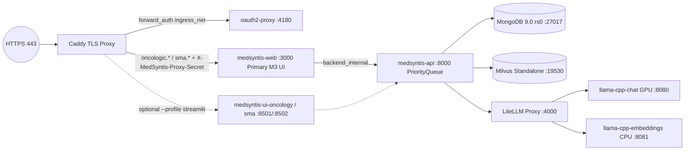

# MedSyntis SRE & DevOps Specialist Skill (`sre-devops-expert`)

Activate this skill whenever designing, auditing, troubleshooting, or optimizing container images, Docker Compose stacks, reverse proxies, SSO authentication, GPU/VRAM inference servers, database operations, observability, or CI/CD pipelines across the repository.

---

## 1. Production Topology & Multi-Domain Architecture

The production stack is defined in [`dist/docker/compose/docker-compose.prod.yml`](../../../dist/docker/compose/docker-compose.prod.yml) and orchestrates:

### Key Architectural Invariants
1. **Primary M3 Web BFF (`medsyntis-web`) & Centralized Queue Worker (`medsyntis-api`)**:
   - `medsyntis-web` (`dist/docker/Dockerfile.web`, Fastify 5 on `:3000`) is the **primary clinical interface** serving both `oncologic.{$PROD_BASE_DOMAIN}` and `sma.{$PROD_BASE_DOMAIN}` via domain-injected headers from Caddy (`X-MedSyntis-Domain`).
   - Legacy Streamlit containers (`medsyntis-ui-oncology` and `medsyntis-ui-sma` on `:8501`/`:8502`) are deprecated and gated behind the optional `--profile streamlit` (`oncologic-st.*` / `sma-st.*`).
   - `medsyntis-api` (`dist/docker/Dockerfile.api`, `uvicorn app-api:app --port 8000`) mounts both domain directories (`/data/medsyntis/oncologic` and `/data/medsyntis/sma`) and hosts the centralized `PriorityQueue` worker so GPU LLM inference is strictly serialized across domains without VRAM contention.
2. **Network Segmentation & Loopback-Only Host Port Exposure**:
   - External traffic terminates at `caddy` (`0.0.0.0:80` and `0.0.0.0:443`) on `ingress_net` alongside `oauth2-proxy`.
   - Internal application, database, and LLM containers communicate over `backend_internal` (`internal: true`, blocking direct outbound internet egress) plus `milvus` for vector search.
   - Every host-mapped diagnostic port (`mongod`, `llama-cpp-chat`, `llama-cpp-embeddings`, `litellm`, `medsyntis-web`, `medsyntis-api`, `oauth2-proxy`, `medsyntis-ui-*`) MUST bind strictly to `127.0.0.1:<port>:<container_port>`.

---

## 2. Container Security & Zero-Trust Hardening (`dist/docker/`)

1. **Multi-Stage Non-Root Dockerfiles & Pinned Tags**:
   - [`dist/docker/Dockerfile.api`](../../../dist/docker/Dockerfile.api) and [`dist/docker/Dockerfile`](../../../dist/docker/Dockerfile) use multi-stage `python:3.13-slim-trixie` builds with pinned `ghcr.io/astral-sh/uv:0.13.7` so compilers (`build-essential`, `gcc`) are never retained in the runtime image; both run as non-root `appuser` (`UID=1002`, `GID=1002`) with `HEALTHCHECK` probes.
   - [`dist/docker/Dockerfile.web`](../../../dist/docker/Dockerfile.web) uses multi-stage `node:26-trixie-slim` with `npm ci --omit=dev`, strips package managers (`npm`/`npx`/`corepack`) from runtime while bundling `public/` and `styleguide/` (served at `/styleguide`), and runs under `dumb-init` as `appuser` (`UID=1002`).
   - In `docker-compose.prod.yml`, services enforce `cap_drop: ["ALL"]`, `security_opt: ["no-new-privileges:true"]` (with minimal `cap_add` only where required by `mongod` and `caddy`), and explicit version tags (e.g., `ghcr.io/berriai/litellm:v1.108.4` — never `:main-latest`).
2. **Fail-Fast Secret Enforcement & Zero Telemetry**:
   - Mandatory `${VAR:?...}` expansion is enforced in `docker-compose.prod.yml` for `OAUTH2_PROXY_CLIENT_ID`, `OAUTH2_PROXY_CLIENT_SECRET`, `OAUTH2_PROXY_COOKIE_SECRET`, `APP_MONGODB_PASSWORD`, `LITELLM_MASTER_KEY`, `APP_API_TOKEN`, and `APP_PROXY_SECRET` (`make init-prod` generates cryptographic secrets into `.env.prod` with `chmod 0600`).
   - All services disable outbound telemetry and runtime model hub downloads (`LITELLM_TELEMETRY="False"`, `telemetry: false` in `litellm-config*.yaml`, `HF_HUB_OFFLINE="1"`, `TRANSFORMERS_OFFLINE="1"`, `ANONYMIZED_TELEMETRY="False"`, `SCARF_NO_ANALYTICS="true"`, `DO_NOT_TRACK="1"`).
3. **Zero-Trust Caddy + OAuth2 Proxy Ingress (`dist/docker/compose/Caddyfile`)**:
   - Enforces `Strict-Transport-Security "max-age=31536000; includeSubDomains"` (`(security_headers)`).
   - Strips client-spoofed headers (`-X-Forwarded-For`, `-X-MedSyntis-Domain`, `-X-MedSyntis-Proxy-Secret`, `-X-Auth-Request-*`, `-X-Forwarded-User/Email/Preferred-Username`) via `(strip_spoofed_headers)` across all upstreams (`oncologic.*`, `sma.*`, `oncologic-st.*`, `sma-st.*`) before `forward_auth`, then injects trusted `X-MedSyntis-Domain` and `X-MedSyntis-Proxy-Secret`.
4. **Least-Privilege Host Sudoers & Staging (`dist/sudoers/medsyntis`, `Makefile`)**:
   - Never use `chmod 777` on host volumes (use `0750`/`0700`) or wildcard `*` rules in `/etc/sudoers.d/medsyntis`; restrict `NOPASSWD` strictly to `/usr/sbin/logrotate /etc/logrotate.d/medsyntis` and stage root-owned configs via `mktemp` (`0600`) + `sudo install`.

---

## 3. GPU / VRAM Capacity Engineering & Local LLM Serving

1. **24 GB VRAM Budget (NVIDIA L4 Profile)**:
   - **Reasoning Server (`llama-cpp-chat`)**:
     - Verifies `/models/Ornith-1.5-35B-A3B-IQ4_XS.gguf` exists locally (failing fast with exit code `1` if missing rather than downloading from HuggingFace), loads weights onto GPU (`-ngl 99`, `--flash-attn on`), quantizes KV cache (`q4_0`) for a `64000` context window, and bounds reasoning tokens (`--reasoning-budget 6144`).
   - **Embeddings Server (`llama-cpp-embeddings`)**:
     - Verifies `/models/bge-m3-Q4_K_M.gguf` (or `F16`/`FP16`) exists locally (failing fast in prod if missing) and runs strictly on CPU (`-ngl 0`, `-c 8192`) so RAG embeddings never contend with chat inference for GPU VRAM.
   - **LiteLLM Unified Gateway (`litellm-config.prod.yaml`)**:
     - Exposes `openai/agents` (`-> http://llama-cpp-chat:8080/v1`) and `openai/embeddings` (`-> http://llama-cpp-embeddings:8080/v1`) with `drop_params: true` and `telemetry: false`.
2. **Cloud Run Dev Tunnel Guardrail (`Makefile`)**:
   - Local developer targets (`cloudrun-proxy`, `start-web-dev`, `start-ui-dev`) require explicit `APP_ALLOW_REMOTE_LLM=true` and display a GDPR/HDS warning forbidding real patient data (PHI) over remote test tunnels.

---

## 4. Database Reliability, Backups & Observability

1. **MongoDB (`medsyntis-mongod`)**:
   - Runs `mongodb/mongodb-community-server:9.0-ubuntu2204` (`--replSet rs0`) protected from Linux OOM killer eviction via `oom_score_adj: -500` and verified via `mongosh` healthchecks.
2. **Milvus Standalone (`dist/docker/compose/milvus-standalone-docker-compose.yml`)**:
   - Orchestrates `milvus-etcd`, `milvus-minio`, and `milvus-standalone` (`:19530` gRPC, `:9091` healthcheck) on the `milvus` network.
3. **Backups & Structured Log Rotation**:
   - `make backup-prod` creates `0700` timestamped archives containing `mongodump --oplog`, domain PDFs/Milvus metadata, and `SHA256SUMS`.
   - Production services write structured JSON logs to `${DOCKER_VOLUME_DIRECTORY:-/data/medsyntis/common}/logs`, rotated by [`dist/logrotate/medsyntis`](../../../dist/logrotate/medsyntis).

---

## 5. CI/CD & DevSecOps Pipeline (`.github/workflows/ci.yml`)

Every change across `application/`, `web/`, `dist/`, or `.github/workflows/` must pass:
1. **Python Quality & Test Gate**: `uv sync --frozen`, `ruff format --check`, `ruff check`, `pyrefly check src`, `pytest --cov=src` on `application/tests/`.
2. **Web M3 Quality, Unit & E2E Gate**: `npm --prefix web ci`, `npm --prefix web run lint` (Biome + `tsc --noEmit` + WCAG contrast check), `npm --prefix web run test` (Vitest), and `npm --prefix web run e2e` (Playwright).
3. **Security & Container Build Gate**:
   - `aquasecurity/trivy-action` (`scanners: "vuln,secret"`, `exit-code: "1"`) scanning `application/`, `web/`, and root `dist/` (`skip-dirs` excludes `web/dist`, not `**/dist`).
   - `docker build` verification for `Dockerfile.api`, `Dockerfile.web`, and `Dockerfile`; GHCR image push runs strictly on `push` to `refs/heads/main` with job-scoped `packages: write`.
   - `sonarcloud` runs only when both Python and Web test jobs succeed (`&&`).
