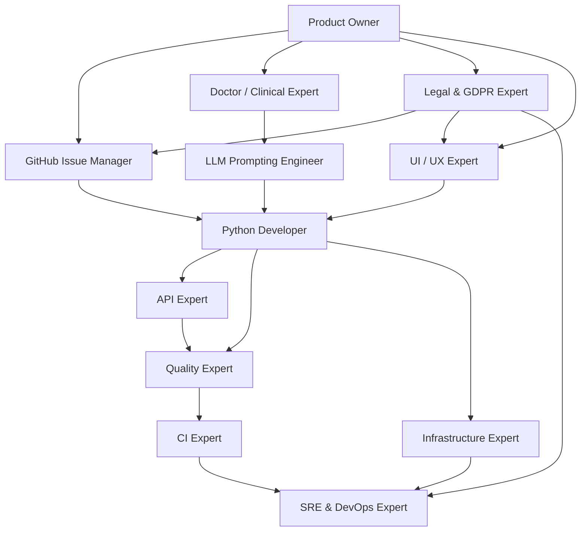

# MedSyntis AI Agent Guidelines (`AGENTS.md`)

Welcome to the **MedSyntis** development guidelines for AI agents and coding assistants. This document acts as a "README for machines," providing explicit instructions, operational workflows, and domain expert guidelines to build, test, and maintain the MedSyntis platform safely and efficiently.

---

## 📖 Project Overview & Tech Stack

MedSyntis is a secure, open-source, 100% local-first clinical web application designed for hospital Multidisciplinary Team Meetings (**MDT / RCP — Réunions de Concertation Pluridisciplinaire**) in **Digestive Oncology** and **Spinal Muscular Atrophy (SMA) / Rare Neuromuscular Diseases**. It leverages local Large Language Models (LLMs) and Retrieval-Augmented Generation (RAG) to:
1. **Analyze Patient Records (`PatientMDTForm`)** to extract structured clinical, biological/genetic, and administrative information across longitudinal MDT sessions.
2. **Detect Missing Records (`MTDCompleted`)** to flag incomplete patient files before the board meeting.
3. **Assess Case Urgency & Schedule Sessions (`MDTAgenda`)** to recommend an optimized MDT passage order and verify specialist quorum.
4. **Integrate National Scientific Reference Guidelines** — **TNCD** (*Thésaurus National de Cancérologie Digestive*) for Digestive Oncology and **PNDS** (*Protocole National de Diagnostic et de Soins*) for Spinal Muscular Atrophy (SMA) — to ground pre-MDT clinical synthesis.

### Technical Stack & Key Dependencies
- **Core Runtime**: Python `>=3.13` (strictly enforced in `application/pyproject.toml` and `application/.python-version`) and Node.js `>=26` (`web/package.json`) for the primary Material Design 3 Web UI (`web/`).
- **Primary Material Design 3 Web UI (`web/`)**: Fastify 5 (`fastify`, `@fastify/cookie`, `@fastify/formbody`, `@fastify/multipart`), TypeScript 7, `zod` 4, `marked` 18, `echarts` 6, self-hosted `ds-*` Design System (WCAG 2.2 AA Light/Dark/Auto themes, strict zero-CDN CSP), Biome 2, Vitest 5, and Playwright E2E.
- **Legacy / Deprecated Frontend Dashboard (`application/src/ui/`, `application/app-ui.py`)**: Streamlit (`streamlit>=1.66.1`, `streamlit-pdf-viewer`, `streamlit-authenticator`). **Deprecated** in favor of `web/`; maintained only as an optional legacy profile (`--profile streamlit`).
- **Backend API & Orchestration (`application/`)**: FastAPI (`application/app-api.py`), Uvicorn, `pydantic-settings`, and LangChain (`langchain-core`, `langchain-litellm`, `langchain-openai`, `langchain-ollama`, `langchain-milvus`, `langchain-mongodb`, `langchain-docling`).
- **Vector Search Databases**:
  - Milvus Standalone `v3.0.4` (`pymilvus>=3.0.2`, `langchain-milvus>=0.4.0`) for primary domain-scoped retrieval.
  - Chroma (`chromadb>=1.5.9`, `langchain-chroma`) as lightweight local/test alternative.
- **Document & Metadata DB**: MongoDB `9.0` Replica Set (`pymongo>=4.19.0`, `langchain-mongodb`) for domain-scoped `PatientRecord`, `PatientMDTForm`, `MDTAgenda`, `BugReport`, and OCR document caches.
- **Document Parsers**: Docling (`docling`, `docling-core`), PyMuPDF (`pymupdf`), Ollama OCR (`ollama-ocr`), and OpenParse (`openparse`).
- **Local LLM Serving Engine**:
  - **LiteLLM Gateway + `llama.cpp` (Default / Production on NVIDIA L4 24 GB)**: `Ornith-1.5-35B-A3B-IQ4_XS.gguf` on GPU (`llama-cpp-chat`) for clinical extraction/reasoning and `bge-m3-Q4_K_M.gguf` on CPU (`llama-cpp-embeddings`) for vector embeddings.
  - **Local Ollama (Alternative Dev Stack)**: `mistral-nemo` for reasoning, `granite3.2-vision` for VLM OCR, and `nomic-embed-text` for embeddings.

---

## 🛠️ Executable Commands & Development Workflows

All commands below are designed to execute cleanly from the **repository root** (`/home/guillaume/git/oncoflow`):

| Operation | Command (from repo root) | Purpose |
| :--- | :--- | :--- |
| **Verify Tooling** | `rtk --version` | Verify the Rust Token Killer utility |
| **Environment Check** | `rtk gain` | View token analytics and dev operation savings |
| **Docker Compose** | `docker compose -f dist/docker/compose/milvus-standalone-docker-compose.yml up -d` | Spin up local Milvus Standalone database |
| **Install Python Deps** | `uv sync --project application` | Install locked Python dependencies in `application/.venv` |
| **Run Python Linter** | `uv run --project application ruff check application/src/` | Lint Python files with Ruff rules |
| **Format Python Code** | `uv run --project application ruff format application/src/` | Format Python files according to PEP8 |
| **Run Git Hooks** | `prek run` or `make hooks` | Run Git pre-commit hooks (Rust-native `prek`) |
| **Run Python Tests** | `uv run --project application pytest application/tests/` | Run Pytest unit & integration test suite |
| **Run Primary Web UI** | `make start-web` (or `npm --prefix web run dev`) | Start FastAPI (`:8000`) + Primary M3 Web UI (`:3000`) |
| **Run Legacy Streamlit**| `uv run --project application streamlit run application/app-ui.py` | Start deprecated legacy Streamlit UI locally (`:8501`) |
| **Web UI Install** | `npm --prefix web ci` | Install locked Node.js dependencies for the M3 Web UI |
| **Web UI Lint & WCAG** | `npm --prefix web run lint` | Run Biome, TypeScript typecheck, and WCAG 2.2 AA contrast check |
| **Web UI Unit/Int Tests**| `npm --prefix web run test` | Run Vitest unit & Fastify BFF integration tests |
| **Web UI E2E Tests** | `npm --prefix web run e2e` | Run Playwright E2E clinical & mobile journeys |
| **Canonical Migration** | `make migrate` | Migrate legacy PDFs, `.bbox` sidecars, MongoDB schemas/IDs, and Milvus collections (`DRY_RUN=1` to preview) |
| **Migrate Patient IDs** | `make patient-id-migrate` | Migrate legacy cleartext `patient_id` slugs in MongoDB to SHA-256 IDs (`DRY_RUN=1` to preview) |

---

## 🛡️ Critical Boundaries & Rules (MUST NEVER VIOLATE)

> [!CAUTION] **Patient Data Privacy (100% Local-Only Execution)**
> MedSyntis processes highly confidential medical records. **Never use public APIs or remote cloud services** (such as OpenAI, Anthropic, Google Cloud, or hosted embedding servers) for parsing or model invocation with patient data. All production operations must run 100% locally via local Docker services (Milvus, MongoDB) and local LLM servers (`LiteLLM` + `llama.cpp` or local `Ollama`) with `APP_ALLOW_REMOTE_LLM=false`.

> [!WARNING] **Dependency Synchronization**
> Always respect `application/pyproject.toml` (`application/uv.lock`) and `web/package.json` (`web/package-lock.json`). Never install unpinned ad-hoc packages.

> [!IMPORTANT] **Model Identifier Check**
> Never hardcode or guess model identifiers. Always resolve LLM and embedding configurations dynamically from `AppConfig.llm`.

---

## 🤝 Multi-Agent Expert Skills & Subagents

MedSyntis defines custom agent skills in `.agents/skills/` and subagents in `.agents/agents/` to capture specific domain expertise. These skills and subagents are automatically discoverable by Google Antigravity SDK agents.



### 1. 🐍 Python Developer
- **Domain**: Advanced Python constructs, LangChain API usage, database connection pools, parser performance.
- **Location**: [python-developer/SKILL.md](.agents/skills/python-developer/SKILL.md)

### 2. ✍️ LLM Prompting Engineer
- **Domain**: System instructions, structured outputs, validation, retry strategies, and LLM temperature behaviors.
- **Location**: [llm-prompting-engineer/SKILL.md](.agents/skills/llm-prompting-engineer/SKILL.md)

### 3. 📋 Product Owner (`product-owner` Subagent & Skill)
- **Domain**: MedSyntis product vision & 3 promises, Multidisciplinary Team Meeting (RCP/MDT) functional specifications (Oncology & SMA), hospital personas (Physician vs RCP Medical Secretary), longitudinal multi-RCP patient consolidation, non-prescriptive medico-legal positioning (`CareOrientationProposal`), and human-in-the-loop edit preservation (`manual_edits`).
- **Locations**:
  - Subagent: [product-owner.md](.agents/agents/product-owner.md)
  - Skill: [product-owner/SKILL.md](.agents/skills/product-owner/SKILL.md)

### 4. 🩺 Doctor (Clinical Expert)
- **Domain**: Medical nomenclature, oncology staging relevance (TNCD), SMA neuromuscular follow-up (PNDS), clinical correlation validity.
- **Location**: [doctor/SKILL.md](.agents/skills/doctor/SKILL.md)

### 5. 🚀 CI Expert
- **Domain**: Automated pipelines, code syntax checking, dependency validation, test orchestration.
- **Location**: [ci-expert/SKILL.md](.agents/skills/ci-expert/SKILL.md)

### 6. 🌐 Infrastructure Expert
- **Domain**: Standalone Docker services, database connections (Milvus, MongoDB, Chroma), hardware acceleration, and memory footprint constraints.
- **Location**: [infrastructure-expert/SKILL.md](.agents/skills/infrastructure-expert/SKILL.md)

### 7. 🎯 Quality Expert
- **Domain**: Unit test coverage, exception safety, logging consistency (`APP_LOG_LEVEL`), and edge-case validation.
- **Location**: [quality-expert/SKILL.md](.agents/skills/quality-expert/SKILL.md)

### 8. 🎨 UI / UX Expert (`ui-ux-expert` Subagent & Skill)
- **Domain**: MedSyntis brand identity, hospital-grade clinical ergonomics (zero-friction readability for physicians and MDT medical secretaries), primary Material Design 3 Web UI (`web/`, `ds-*` tokens, WCAG 2.2 AA Light/Dark/Auto), and legacy deprecated Streamlit views (`application/src/ui/` and `application/app-ui.py`).
- **Locations**:
  - Subagent: [ui-ux-expert.md](.agents/agents/ui-ux-expert.md)
  - Skill: [ui-ux-expert/SKILL.md](.agents/skills/ui-ux-expert/SKILL.md)

### 9. 🔌 API Expert (`medsyntis-api-expert` Subagent & `api-expert` Skill)
- **Domain**: Cross-Domain FastAPI architecture (`application/app-api.py`, `application/src/routers/`, `application/src/models/`), `PriorityQueue` SSE streaming (`EventSourceResponse`), multi-domain middleware (`AllowedDomainMiddleware`), dependency injection (`Annotated[..., Depends(...)]`), OpenAPI 3.1 contracts, and Hexagonal/DDD router boundaries.
- **Locations**:
  - Subagent: [api-expert.md](.agents/agents/api-expert.md)
  - Skill: [api-expert/SKILL.md](.agents/skills/api-expert/SKILL.md)

### 10. 🛡️ SRE & DevOps Specialist (`sre-devops-expert` Subagent & Skill)
- **Domain**: Production Docker & Docker Compose stacks (`dist/docker/`), container security hardening (`cap_drop: ALL`, `no-new-privileges`, loopback port bindings, `backend_internal` network isolation), Zero-Trust Caddy + OAuth2-Proxy SSO ingress (`Caddyfile`), GPU/VRAM capacity planning (`llama.cpp` on L4 24GB + CPU `bge-m3` embeddings + `LiteLLM` gateway), MongoDB & Milvus reliability, structured JSON logging/logrotate, and GitHub Actions DevSecOps pipelines (`.github/workflows/ci.yml`).
- **Locations**:
  - Subagent: [sre-devops-expert.md](.agents/agents/sre-devops-expert.md)
  - Skill: [sre-devops-expert/SKILL.md](.agents/skills/sre-devops-expert/SKILL.md)

### 11. 🎫 GitHub Issue Manager (`github-issue-manager` Subagent & `github-issue-architect` Skill)
- **Domain**: 100% English GitHub issue & Milestone governance (`.github/ISSUE_TEMPLATE/`), strict separation between pure business **Stories** (`01_story.yml` + Milestone validated by `product-owner`), actionable **Features** (`02_feature.yml` linked to a Story with Objective, Tasks & DoD), and **Bugs** (`03_bug.yml` with mandatory Description & DoD), automatic completeness triage (`status:to-complete` vs `status:ready`), and logical label taxonomy (`.github/labels.yml`).
- **Locations**:
  - Subagent: [github-issue-manager.md](.agents/agents/github-issue-manager.md)
  - Skill: [github-issue-architect/SKILL.md](.agents/skills/github-issue-architect/SKILL.md)

### 12. ⚖️ French GDPR & Medical-Legal Expert (`legal-gdpr-expert` Subagent & Skill)
- **Domain**: French & European health data protection (**RGPD / GDPR**, **Loi Informatique et Libertés Art. 64–70**, **CNIL** health referentials, **HDS Art. L. 1111-8 CSP**, **PGSSI-S**), French Public Health Code (**Secret médical & Équipe de soins Art. L. 1110-4 / L. 1110-12 CSP**, **Garantie Humaine IA Art. L. 4001-2 CSP**, **Organisation des RCP Art. D. 6124-131 CSP / INCa / HAS / TNCD / PNDS**), **EU Medical Device Regulation (MDR 2017/745 Rule 11 & MDCG 2019-11)** non-prescriptive positioning, and **EU AI Act (2024/1689)** human oversight, transparency, and anti-hallucination grounding.
- **Locations**:
  - Subagent: [legal-gdpr-expert.md](.agents/agents/legal-gdpr-expert.md)
  - Skill: [legal-gdpr-expert/SKILL.md](.agents/skills/legal-gdpr-expert/SKILL.md)

---

## ⚡ MCP Server & Context7 Integration

To provide real-time, version-specific package documentation during development, Upstash Context7 MCP is integrated.

### 1. Global Editor Configuration
Add the Context7 server definition to your editor/client configuration (e.g. Cursor, Claude Desktop, or Windsurf config files):

```json
{
  "mcpServers": {
    "context7": {
      "command": "npx",
      "args": [
        "-y",
        "@upstash/context7-mcp"
      ]
    }
  }
}
```

### 2. Usage Instructions
Trigger the context server in your prompts by suffixing:
> "How do I optimize a Milvus similarity search in LangChain? use context7"

This injects the exact, up-to-date documentation directly into the context window, eliminating hallucinations and stale API usage.

### 3. Adding Skills via Context7 CLI
Context7 provides a CLI wizard to search, install, and generate modular skills for your agent using official docs:
- **Search existing skills**: `npx ctx7 skills search <keywords>`
- **Install specialized community skills**: `npx ctx7 skills install <owner/repo>`
- **Launch the Skill Wizard to generate a skill**: `npx ctx7 skills generate`

---

## 🚫 Streamlit Architectural Boundary (CRITICAL RULE)

> [!CAUTION]
> **STREAMLIT IS STRICTLY FORBIDDEN OUTSIDE THE LEGACY UI ADAPTER LAYER (`application/src/ui/`).**
> Importing `streamlit` (`import streamlit as st`) or referencing `st.session_state` is strictly restricted to `application/app-ui.py` and files under `application/src/ui/` (which is deprecated in favor of the primary Material Design 3 Web UI in `web/`).
> Core backend layers (`application/src/domain/`, `application/src/application/`, `application/src/infrastructure/`, and `application/src/routers/`) MUST remain 100% framework-neutral and completely free of any Streamlit coupling to preserve Hexagonal/DDD modularity and testability (`application/tests/test_ddd_architecture.py`).
