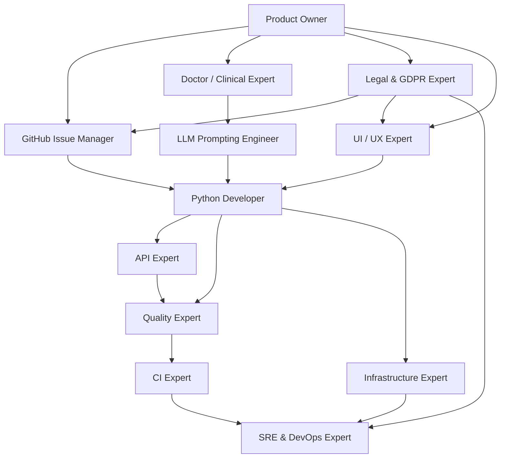

# MedSyntis AI Agent Guidelines (`application/AGENTS.md`)

Welcome to the **MedSyntis** development guidelines for AI agents and coding assistants working inside `application/`. This document acts as a "README for machines," providing explicit instructions, operational workflows, and domain expert guidelines to build, test, and maintain the MedSyntis Python backend and Streamlit UI safely and efficiently.

---

## 📖 Project Overview & Tech Stack

**MedSyntis** is a secure, open-source, local-first clinical web application designed for healthcare professionals (surgeons, physicians, oncologists,rare disease specialists, and MDT/RCP medical secretaries). It leverages local Large Language Models (LLMs) and Retrieval-Augmented Generation (RAG) to:
1. **Analyze Patient Records (`PatientMDTForm`)** to extract structured administrative and clinical information.
2. **Detect Missing Records** to flag incomplete patient files before the MDT meeting.
3. **Assess Case Urgency** and recommend an optimized MDT/RCP meeting order.
4. **Integrate Scientific Reference Guidelines** (TNCD in Oncology, PNDS in SMA) to ground clinical preparation.

### Technical Stack & Key Dependencies
- **Core Runtime**: Python `>=3.13` (strictly enforced in `application/pyproject.toml`).
- **Cross-Domain REST & SSE API**: FastAPI (`fastapi>=0.162.0`, `uvicorn>=0.54.0`, `app-api.py`).
- **Streamlit Dashboard**: Streamlit (`streamlit>=1.66.1`, `streamlit-pdf-viewer>=0.0.30`, `streamlit-authenticator>=0.4.2`, `app-ui.py`).
- **Orchestration**: LangChain (`langchain-core`, `langchain-ollama`, `langchain-milvus`, `langchain-mongodb`, `langchain-docling`).
- **Vector Search Databases**:
  - Milvus (`pymilvus>=3.0.2`, `langchain-milvus>=0.4.0`) for primary retrieval (`medsyntis` database, `medsyntisDocs` collection).
  - Chroma (`chromadb>=1.5.9`, `langchain-chroma`) as an alternative.
- **Document Store**: MongoDB (`pymongo>=4.19.0`, `langchain-mongodb`) for caching and storing patient records metadata (`MedSyntis` and `MedSyntisVector`).
- **Document Parsers**: Docling (`docling-core`), MuPDF (`pymupdf`), Ollama OCR (`ollama-ocr`), OpenParse (`openparse`).
- **Local LLM Engine**: LiteLLM / llama.cpp / Ollama (configured via `AppConfig.llm`).

---

## 🛠️ Executable Commands & Development Workflows

All development operations inside `application/` must follow these exact shell commands:

| Operation | Command | Purpose |
| :--- | :--- | :--- |
| **Verify Tooling** | `rtk --version` | Verify the Rust Token Killer utility |
| **Environment Check** | `rtk gain` | View token analytics and dev operation savings |
| **Docker Compose** | `docker compose -f ../dist/docker/compose/milvus-standalone-docker-compose.yml up -d` | Spin up local Milvus Standalone database |
| **Install Dependencies**| `uv sync` | Fast dependency resolution using `uv.lock` |
| **Run Linter** | `uv run ruff check src/ tests/` | Lint Python files with Ruff rules |
| **Format Code** | `uv run ruff format src/ tests/` | Format Python files according to PEP8 |
| **Run Unit Tests** | `uv run pytest` | Run the full MedSyntis Python test suite |
| **Run API Dev Mode** | `uv run python app-api.py` | Start the Cross-Domain FastAPI server locally |
| **Run UI Dev Mode** | `uv run streamlit run app-ui.py` | Start the Streamlit UI server locally |

---

## 🛡️ Critical Boundaries & Rules (MUST NEVER VIOLATE)

> [!CAUTION] **Patient Data Privacy (Local-Only Execution)**
> MedSyntis processes highly confidential medical data. **Never use public APIs or remote cloud services** (such as OpenAI, Anthropic, or external embedding servers) for parsing or model invocation. All operations must run locally via local Docker services (Milvus, MongoDB) or local LLM servers to guarantee hospital data compliance.

> [!WARNING] **Dependency Synchronization**
> Always respect `application/pyproject.toml` dependencies. Do not use ad-hoc versions. Use `application/uv.lock` to pin dependencies.

> [!IMPORTANT] **Model Identifier Check**
> Do not assume model identifiers are available or guess their configurations. Always fall back to `AppConfig.llm` parsed environment configurations.

---

## 🤝 Multi-Agent Expert Skills

MedSyntis defines custom agent skills in `../.agents/skills/` and subagents in `../.agents/agents/` to capture specific domain expertise:

- **Python Developer**: [../.agents/skills/python-developer/SKILL.md](../.agents/skills/python-developer/SKILL.md)
- **LLM Prompting Engineer**: [../.agents/skills/llm-prompting-engineer/SKILL.md](../.agents/skills/llm-prompting-engineer/SKILL.md)
- **Product Owner**: [../.agents/skills/product-owner/SKILL.md](../.agents/skills/product-owner/SKILL.md)
- **Doctor (Clinical Expert)**: [../.agents/skills/doctor/SKILL.md](../.agents/skills/doctor/SKILL.md)
- **CI Expert**: [../.agents/skills/ci-expert/SKILL.md](../.agents/skills/ci-expert/SKILL.md)
- **Infrastructure Expert**: [../.agents/skills/infrastructure-expert/SKILL.md](../.agents/skills/infrastructure-expert/SKILL.md)
- **Quality Expert**: [../.agents/skills/quality-expert/SKILL.md](../.agents/skills/quality-expert/SKILL.md)
- **UI / UX Expert**: [../.agents/skills/ui-ux-expert/SKILL.md](../.agents/skills/ui-ux-expert/SKILL.md)
- **API Expert**: [../.agents/skills/api-expert/SKILL.md](../.agents/skills/api-expert/SKILL.md)
- **SRE & DevOps Expert**: [../.agents/skills/sre-devops-expert/SKILL.md](../.agents/skills/sre-devops-expert/SKILL.md)
- **GitHub Issue Architect**: [../.agents/skills/github-issue-architect/SKILL.md](../.agents/skills/github-issue-architect/SKILL.md)
- **Legal & GDPR Expert**: [../.agents/skills/legal-gdpr-expert/SKILL.md](../.agents/skills/legal-gdpr-expert/SKILL.md)
- **DDD & TDD Architect**: [../.agents/skills/ddd-tdd-architect/SKILL.md](../.agents/skills/ddd-tdd-architect/SKILL.md)
- **Ubiquitous Language (English)**: [../.agents/skills/ubiquitous-language-english/SKILL.md](../.agents/skills/ubiquitous-language-english/SKILL.md)

---

## 🚫 Streamlit Architectural Boundary (CRITICAL RULE)

> [!CAUTION]
> **STREAMLIT IS STRICTLY FORBIDDEN OUTSIDE THE UI LAYER.**
> Importing `streamlit` (`import streamlit as st`) or accessing `st.session_state` is strictly restricted to `app-ui.py` and files under `src/ui/`.
> Core application layers (`src/application/`, `src/infrastructure/`, `src/domain/`, `src/routers/`, `src/models/`) must remain 100% framework-neutral and free of any direct coupling with Streamlit to preserve modularity and testability.
